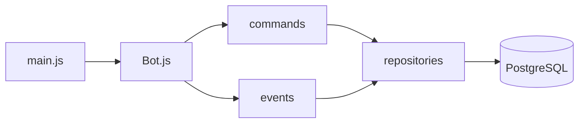

# hanako-bot

Bot de Discord para **un solo servidor**: niveles (XP por chat y por voz), recompensas por rol, detección de AFK, moderación y cumpleaños con timezones. Todo se configura desde Discord con el panel `/config`.

**Stack**: Node.js · discord.js v14 · PostgreSQL 16 · Docker.

## Features

| Módulo | Qué hace |
|---|---|
| **Niveles** | XP por mensaje y por minuto en voz; `/rank`, `/top` |
| **Recompensas** | Rol automático al subir de nivel |
| **AFK** | Detección en el canal AFK de voz + auto-respuesta al mencionar |
| **Cumpleaños** | `/birthday` con timezone y anuncio diario |
| **Moderación** | `/purge` |
| **Config** | Panel interactivo `/config` (slash-only) |

## Quick start

1. **Requisitos**: Node.js 22+, PostgreSQL 16 (o Docker).
2. **Entorno**: `make setup` (crea `.env` desde `.env.example`) y editalo.
3. **Dependencias**: `npm install`
4. **Correr**: `npm run dev` (nodemon) o `make up` (Docker).
5. Invitá el bot al servidor y configurá todo con `/config`.

### Variables mínimas (`.env`)

| Variable | Para qué |
|---|---|
| `CLIENT_TOKEN` | Token del bot |
| `GUILD_ID` | El servidor (único) |
| `DATABASE_URL` | Conexión a PostgreSQL |
| `OWNER_ID` | Tu user ID (comandos owner-only) |

El resto de la configuración se maneja desde `/config` y se persiste en la base.

## Configuración

- **Boot / secretos** (env, fuera del panel): `CLIENT_TOKEN`, `GUILD_ID`, `OWNER_ID`, `DATABASE_URL`.
- **Guild settings** (editables con `/config`): XP, notificaciones, canales, roles, AFK, cumpleaños. Se resuelven con precedencia **DB > env > default**; el schema vive en `src/config/settings.js`.

## Arquitectura

```
main.js → src/models/Bot.js → commands / events → repositories → PostgreSQL
```

- **2-tier (repo → command)**: comandos y eventos usan los repositorios directo. Sin capa de servicios ni DI (`docs/adr/0003`).
- **Single-guild**: el bot sirve un solo servidor (`docs/adr/0001`).
- **Slash-only**, y la configuración tiene una única fuente de verdad (`docs/adr/0002`).



## Comandos (Make)

| Comando | Hace |
|---|---|
| `make help` | Lista los targets |
| `make setup` | Crea `.env` desde `.env.example` |
| `make check` | lint + test (lo mismo que el CI) |
| `make backup` | Backup de PostgreSQL |
| `make up` / `make down` | Levanta / baja el stack (Docker) |
| `make logs` | Logs del bot |

Para el día a día, los scripts de `npm`: `npm run dev`, `npm test`, `npm run lint`.

## Desarrollo

- **Tests**: `npm test` (Jest). El CI corre en cada PR a `master`.
- **Lint**: `npm run lint` (ESLint, tabs). `make check` corre ambos.
- **Pre-commit**: husky corre lint + test.
- **Decisiones**: `docs/adr/`.
- **Workflow**: trunk-based — ramas cortas desde `master`, PR obligatorio.

## Deploy

`docker compose up -d` (se une a la red externa `infra-red`).

> ⚠️ **El build sale del working tree, no de un commit.** Taggeá lo que desplegás, o un archivo sin commitear puede terminar en producción.
