# hanako-bot

Bot de Discord para **un solo servidor**: sistema de niveles, recompensas por rol, detección de AFK, moderación y cumpleaños con timezones. Todo se configura desde Discord con el panel `/config`.

## Qué hace

Cubre las mecánicas que un servidor chico necesita sin depender de bots de terceros: da XP por mensaje y por minuto en voz, asigna roles al subir de nivel, detecta cuándo alguien se ausenta, anuncia cumpleaños y permite purgar mensajes. Lo armé para mi propio servidor, así que cada decisión prioriza algo **simple de mantener por una sola persona**.

## Tech stack

- **Runtime**: Node.js en un solo proceso, sin frameworks de más.
- **Discord**: discord.js v14, con slash commands y componentes interactivos.
- **Datos**: PostgreSQL 16 con el driver `pg`: SQL a mano, sin ORM.
- **Deploy**: Docker + docker-compose sobre una infra compartida.
- **Calidad**: Jest · ESLint · husky (lint + test en cada commit) · GitHub Actions.

## Cómo empezar

1. **Requisitos**: Node.js 22+ y PostgreSQL 16 (o Docker).
2. **Entorno**: `make setup` crea `.env` desde `.env.example`; completá `CLIENT_TOKEN`, `GUILD_ID`, `DATABASE_URL` y `OWNER_ID`.
3. **Dependencias**: `npm install`.
4. **Correr**: `npm run dev` (nodemon) o `make up` (Docker).
5. Invitá el bot al servidor y configurá todo con `/config`.

Los comandos son **slash-only**. Cada ajuste (XP, notificaciones, canales, roles…) se edita desde el panel y se persiste en la base; no hace falta tocar `.env` para configurar el servidor.

## Cómo funciona

```
main.js → Bot.js → commands / events → repositories → PostgreSQL
```

`main.js` arranca `Bot.js`, el orquestador: inicializa la base, corre las migraciones, carga comandos y eventos, y registra los slash commands. Los comandos y los eventos usan los **repositorios** directo contra PostgreSQL.



_El diagrama también está como HTML autocontenido en `docs/architecture.html`._

Tres decisiones que vale la pena mirar (documentadas en `docs/adr/`):

- **2-tier (repo → command)**: sin capa de servicios ni contenedor de DI. Un intento anterior de CSR (controller–service–repository) se revirtió a propósito.
- **Single-guild**: el bot sirve un solo servidor, así que la dimensión `guild_id` se eliminó del modelo de datos.
- **Configuración de fuente única** (`src/config/settings.js`): el runtime y el panel leen la misma tabla, con precedencia `DB > env > default`.

## Aprendizajes

- **Deshacer un refactor enseña más que hacerlo.** Llegar a CSR con DI y después volver a 2-tier me dejó claro cuál es el alcance real de un proyecto chico.
- **La sobre-ingeniería se paga.** Para un bot de un solo servidor, multi-guild y una capa de servicios eran indirección sin valor.
- **Una segunda fuente de verdad siempre diverge.** Teníamos dos tablas de configuración; ya habían discrepado en producción (un default distinto en cada una).
- **Una migración se valida contra datos reales.** Las `ALTER TABLE` que colapsan `guild_id` se probaron contra un Postgres con datos antes de tocar el servidor.

## Licencia

MIT. Ver [`LICENSE`](LICENSE).
